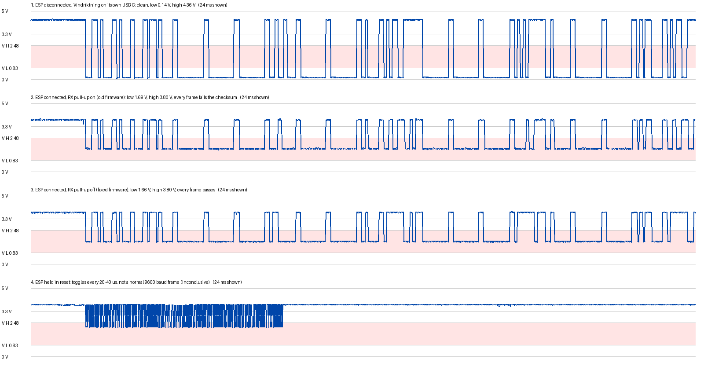

Vindriktning REST signal investigation, 2026-11-01
==================================================

The vindriktning firmware on an ESP32-C3 received every PM1006 frame from the IKEA Vindriktning with checksum errors. This folder documents how that was investigated with an oscilloscope, what was found, the firmware change that made reception work, and what is still open. It also covers a test of the UDP multicast messages over Wi-Fi, done the same day.

Summary
-------

- The firmware's UART settings and checksum code are correct. The fault is electrical.
- With nothing else connected, the Vindriktning's REST pad carries a clean 5 V logic signal: 0.14 V low, 4.36 V high.
- With the ESP32-C3's RX pin (GPIO20) connected, the low level rises to about 1.7 V and the high level is held at about 3.8 V. The ESP32-C3 needs a low below 0.83 V to be sure to read 0, so 1.7 V can be read either way, and bits were read wrong.
- Disabling the internal pull-up on GPIO20 made every frame pass the checksum (47 of 47 afterwards, against 11 of 11 failing just before in the same setup). The line's low level only dropped by 20 to 40 mV, though. The most likely reading is that the low sits right at the ESP32-C3's switching point, so this works with very little margin.
- Not explained: why connecting the ESP32-C3's pin raises the low level at all.
- Recommended next step: a 5 V-tolerant buffer between REST and GPIO20, so the ESP32-C3's pin is no longer on the REST line (see [Open items](#open-items)).
- The UDP multicast messages are sent, but the IoT Wi-Fi isolates its clients, so no other device on it receives them. A separate sensor Wi-Fi without client isolation was chosen as the fix.



Hardware and software
---------------------

| Part | Details |
|---|---|
| Microcontroller | DFRobot Beetle ESP32-C3 (chip revision v0.4, 4 MB flash), connected to the computer over its built-in USB-Serial-JTAG port (`/dev/ttyACM0`) |
| Sensor | IKEA Vindriktning, with its Cubic PM1006 particle sensor. Its REST pad carries the sensor's serial output: 9600 baud, 8 data bits, no parity, 1 stop bit, 20-byte frames starting `16 11 0B`, with a checksum that makes all 20 bytes sum to 0 (mod 256) |
| Wiring | Vindriktning REST pad to Beetle GPIO20, GND to GND. In the original setup the Beetle's VIN pin powers the Vindriktning's +5V pad |
| Firmware | `firmware/vindriktning` at commit `3b07895`, built with ESP-IDF v6.1 in the dev container (`.devcontainer/`). UART1, RX on GPIO20 (`CONFIG_UART_RXD`), 9600 8N1, default clock source |
| Oscilloscope | Rigol DS1102Z-E, firmware 00.06.03.SP2, controlled from the computer over USB (see [Appendix A](#appendix-a-controlling-the-scope-over-usb)). CH1 with its probe at 10X, CH2 with its probe at 1X |

### Setups

| Setup | Vindriktning powered by | Beetle powered by | Wires between the boards |
|---|---|---|---|
| A, original | Beetle VIN | Computer USB | VIN, GND, REST to GPIO20 |
| B, ESP disconnected | Its own USB-C charger | Not connected | GND only |
| C | Its own USB-C charger | Meant to be powered from VIN, no USB | VIN, GND, REST to GPIO20 |
| D, separate supplies | Its own USB-C charger | Computer USB | GND, REST to GPIO20 |

Symptom
-------

- First run, setup A ([log 01](logs/01-first-flash.log)): reads of 7 to 13 bytes, nearly all `0xFF` and `0xDF`, rejected as `Invalid data length`.
- Second run, setup A ([log 02](logs/02-second-run.log)): full 20-byte frames, usually with the right `16 11 0B` header, but every frame fails the checksum. Nearly all wrong bits are 0 read as 1, for example `00` read as `40`, `80` or `48`.

What was ruled out in the firmware:

- The UART is set to 9600 baud, 8N1, no flow control, with the default (accurate) clock source. That matches the PM1006.
- The checksum code is correct. One received frame, `16 11 0b 00 01 00 0b 00 00 02 d4 00 00 01 2c 02 08 04 0d d1`, sums to `0x22D`, which is 45 mod 256, the same value the parser reported. So that frame really was corrupt.

Measurements
------------

All voltages are from the scope's own measurements of each capture (`:MEAS:VBASE?` for the low level, `:MEAS:VTOP?` for the high level), unless noted. At 1 V/div, the scope resolves 40 mV per step. "Frames OK" comes from the ESP's log during the same setup.

| # | Setup | ESP | Probes | Low | High | Frames OK | Files |
|---|---|---|---|---|---|---|---|
| 01 | A | Running, pull-up on | CH2 on GPIO20 | 1.68 V ¹ | 3.74 V ¹ | 0 | [capture](captures/01-gpio20-esp-running-raw.json), [plot](plots/raw-readout-artifact-gpio20.png) |
| 02 | A | Running, pull-up on | CH1 on REST, CH2 on GPIO20 | 1.70 V / 1.69 V | 3.82 V / 3.76 V | 0 | [capture](captures/02-rest-and-gpio20-esp-running-raw.json), [plot](plots/raw-readout-artifact-both-ends.png) |
| 03 | A | Held in reset | CH1 on REST, CH2 on GPIO20 | 2.16 V / 2.08 V ² | 3.82 V / 3.76 V | - | [capture](captures/03-rest-and-gpio20-esp-in-reset.json) |
| 04 | B | Disconnected | CH1 on REST, CH2 on Vindriktning +5V | 0.14 V | 4.36 V | - | [capture](captures/04-rest-esp-disconnected.json) |
| 05 | C | Unknown ³ | CH1 on REST, CH2 on Vindriktning +5V | 0.14 V | 4.35 V | - | [capture](captures/05-rest-esp-on-vin-no-usb.json) |
| 06 | D | Running, pull-up on | CH1 on REST, CH2 on Vindriktning +5V | 1.69 V | 3.80 V | 0 of 11 | [capture](captures/06-rest-esp-connected-pullup-on.json), [log](logs/06-esp-connected-pullup-on.log) |
| 07 | D | Running, pull-up off | CH1 on REST, CH2 on Vindriktning +5V | 1.66 V | 3.80 V | 17 of 17 | [capture](captures/07-rest-esp-connected-pullup-off.json), [log](logs/07-esp-connected-pullup-off.log) |

¹ From the waveform data (2nd percentile and resting level), no scope measurement was taken for this capture.
² Capture 03 does not show a normal frame: the line toggles every 20 to 40 µs for about 7 ms, where a 9600 baud bit lasts 104 µs. These values describe that burst, not a sensor frame, so the test is inconclusive.
³ The line looked exactly as with the ESP disconnected, and the ESP did not answer on the network. Most likely it was not powered through VIN, or the data wire was not connected. Inconclusive.

Further readings:

- The Vindriktning's supply was steady at 4.92 to 5.00 V during frames (CH2 in captures 04 to 07).
- Between frames, the line averaged 3.81 V with the ESP connected (captures 06, 07) and 4.35 V without it (04, 05).
- Average low level of all low samples: 1.684 V in capture 06 (pull-up on), 1.663 V in capture 07 (pull-up off). A capture made while writing this document, in setup D with the pull-up off, measured 1.662 V.
- After the change, two more runs in setup D received 16 of 16 and 14 of 14 frames correctly ([log 08](logs/08-after-fix-run-2.log), [log 09](logs/09-multicast-test-esp.log)).

Findings
--------

1. **The wire and the ground connection are fine.** In capture 02, CH1 at the REST pad (ground clip on the Vindriktning's GND) and CH2 at GPIO20 (ground clip on the Beetle's GND) were in the same logic state in 99.7 % of samples, with a median difference of 0.07 V.

2. **The Vindriktning on its own produces a clean signal.** With the ESP disconnected (capture 04), the low is 0.14 V and the high 4.36 V. It is 5 V logic.

3. **Connecting the ESP32-C3's pin changes the signal.** In every setup where the ESP was running and connected (01, 02, 06, 07), the low was 1.66 to 1.70 V and the high 3.74 to 3.82 V. This happened both when the Beetle powered the Vindriktning (A) and with separate supplies (D), so it is not caused by how the boards are powered.

4. **The high level is the ESP32-C3's protection diode.** 3.8 V is the 3.3 V supply plus a diode drop. The pin's protection diode conducts and holds the 4.4 V signal down. The ESP32-C3's pins are not rated for voltages above their supply.

5. **1.7 V is in the ESP32-C3's undefined input range.** Its datasheet guarantees a 0 below 0.25 × VDD (0.83 V) and a 1 above 0.75 × VDD (2.48 V). In between, the result depends on the individual chip, temperature and noise. That matches the errors: 0 bits read as 1.

6. **Disabling the GPIO20 pull-up made reception work.** In ESP-IDF v6.1, `uart_set_pin()` connects the RX pin through the GPIO matrix (`gpio_matrix_input()` in `esp_driver_uart/src/uart.c`) and does not change its pull-up or pull-down. GPIO20 is also the chip's default console RX pin, and the boot log says `GPIO 20 and 21 are used as console UART I/O pins`. Disabling its pull-up changed the result, so it must have been on before. With the change, every frame passed in three runs (47 of 47), against 11 of 11 failing just before in the same setup.

7. **The pull-up did not cause the high low level.** Removing it moved the low level by only 20 to 40 mV (finding 3 and the averages above). The most likely explanation of finding 6 is that the low sits right at this chip's actual switching point, around half of 3.3 V, so a small shift is enough to change how it is read. That is not proven: 20 to 40 mV is at the limit of what the scope resolved at 1 V/div, and it means the current setup works with almost no margin.

8. **The scope's raw memory readout adds fake pulses.** Captures 01 and 02, read in RAW mode (2 channels, 60 000 points), show short pulses of about 50 µs that look like extra bits (see the two `raw-readout-artifact` plots). They are not on the wire: the ESP did not see them, and 59 % of all edges fall on the same three sample positions modulo 128, where real edges would spread evenly (`scripts/edge_phases.py`). Blocks of samples are put in the wrong place during readout. The scope's measurements and the 1200-point NORM readout do not have this problem, apart from point 688, which reads -2.16 V in every NORM capture.

Not explained
-------------

- **Why the ESP32-C3's pin raises the low level to about 1.7 V.** It is not the pull-up (finding 7) and not the power arrangement (finding 3). At 1.7 V neither of the pin's protection diodes conducts, so they do not explain it either. One possibility is that the REST pad is driven through a resistor on the Vindriktning board, so it can be pulled up easily, and something on the ESP side supplies current during lows. Measuring the resistance between the REST pad and the PM1006's TX pin with everything unpowered would test the first part.
- **What the scope saw with the ESP held in reset** (capture 03). It might have caught something other than a sensor frame, or the reset state changes the line in a way not understood.

Changes made
------------

None of these are committed yet.

- `.devcontainer/`: a dev container with ESP-IDF v6.1 (`espressif/idf:v6.1`), running as the non-root `ubuntu` user, with `/dev` mounted for the boards and host networking for the multicast tool.
- `firmware/vindriktning/components/vindriktning-parser/vindriktning_parser.c`: after `uart_set_pin()`, the parser calls `gpio_pullup_dis()` on the RX pin. `CMakeLists.txt` in the same folder now also requires `esp_driver_gpio`. With the pull-up off, an unconnected RX pin floats and may pick up noise. The parser drops frames with a bad checksum.
- This folder.

Open items
----------

In suggested order:

1. **Add a buffer between the REST pad and GPIO20.** A single 5 V-tolerant buffer powered from the Beetle's 3.3 V, such as a 74LVC1G17: REST to its input, its output to GPIO20, its supply to 3V3 and GND. Its input accepts 5 V even when powered at 3.3 V and draws almost no current, so the REST line stays as clean as in capture 04. Its output gives the ESP32-C3 a proper 0 to 3.3 V signal. This also stops the 4.4 V signal from overdriving GPIO20 (finding 4). Avoid ready-made BSS138 level-shifter boards: their 10 kΩ pull-up resistors would load the REST line.
2. **Verify the result** with the scope at GPIO20: low below 0.83 V, high near 3.3 V, and every frame passing.
3. **Checks not done before the scope was disconnected:**
   - Check the scope against its probe-compensation output (a 1 kHz square wave of about 3 V on the front panel), on both channels.
   - Measure at GPIO20 against the Beetle's GND at 0.2 V/div (8 mV per step), with the pull-up on and off, to see exactly how much the change moves the level.
4. **Powering the Beetle from the Vindriktning through VIN** is untested (capture 05). Check that the Beetle starts and joins Wi-Fi before relying on it.
5. **Sensor Wi-Fi** (see [Network test](#network-test)): create it, put its name and password in `wifi_credentials.h`, flash both firmwares, and run `tools/multicast_receiver.py` on a computer on that network.
6. **PM1 and PM10 values.** The firmware reports PM1 at 699 to 735 and PM10 at 183 to 366, while PM2.5 is 3 to 14. The PM1006's maker only documents PM2.5. The other two values come from undocumented fields and are probably not µg/m³ readings.

Network test
------------

The firmware publishes each measurement as UDP multicast to 239.255.10.1, port 45000, with a TTL of 1, so the messages stay on the local network.

- The ESP joined the IoT Wi-Fi and got 192.168.2.211. The computer joined the same Wi-Fi and subnet (192.168.2.24) and the multicast group (shown by `ip maddr`).
- During 60 seconds, the ESP decoded and published 14 measurements without send errors ([log 09](logs/09-multicast-test-esp.log)).
- The computer received none of them ([laptop log](logs/09-multicast-test-laptop.log)). It also could not resolve the ESP's hardware address (ARP stayed incomplete, ping failed), and a packet capture on its Wi-Fi interface (`scripts/sniff.py`) saw no packets from the ESP.
- The IoT Wi-Fi isolates its clients. That stops Wi-Fi devices on it from reaching each other, including the ESP32-C6 receiver.
- Decision: a separate Wi-Fi for the sensors and the receiver, with client isolation off and multicast/broadcast filtering off. It must offer 2.4 GHz, because the ESP32-C3 and ESP32-C6 cannot use 5 GHz.
- If messages arrive at first and then stop after a few minutes, check IGMP snooping on that network. With snooping on and no IGMP querier, switches and access points may stop forwarding the multicast.
- At boot, the first message can fail with errno 118 (host unreachable) because Wi-Fi is not up yet. The module logs this once and logs `Sending again` when sending works.

Appendix A: Controlling the scope over USB
------------------------------------------

The scope (USB ID `1ab1:0517`) appears as `/dev/usbtmc0`, readable by root only.

**Do not use the kernel's usbtmc driver for anything longer than a short reply.** The scope reports 64-byte packets on its high-speed bulk endpoints, which is invalid. The xHCI USB driver assumes 512 bytes, so each 64-byte packet ends a transfer, and replies are cut after 52 bytes. The kernel driver then treats the rest of the reply as new headers (`Device sent reply with wrong MsgID` in the kernel log). A screenshot request (`:DISP:DATA?`) through the kernel driver locked up the scope's USB interface until the scope was switched off and on. A USB port reset did not help. The driver's clear request (`USBTMC_IOCTL_CLEAR`) times out and stalls the endpoint.

**Use `scripts/rigol.py` instead.** It talks to the scope through pyusb, detaches the kernel driver while it runs, and reads one packet at a time until a reply is complete. In a terminal in the dev container, which runs privileged with `/dev` mounted, from the repository root:

```
python -m pip install --target /tmp/pylib pyusb
cd docs/vindriktning-rest-signal/scripts
sudo env PYTHONPATH=/tmp/pylib "$(which python)" rigol.py '*IDN?'
sudo env PYTHONPATH=/tmp/pylib "$(which python)" capture.py capture.json
```

`$(which python)` is ESP-IDF's Python, which also has pyserial, needed by `capture.py --hold-esp-in-reset`.

What to trust:

- `:MEAS:...?` results, which the scope computes from its full memory.
- `:WAV:MODE NORM` data, 1200 points of what is on the screen, except point 688.
- **Not** `:WAV:MODE RAW` data with two channels on at 60 000 points (finding 8). After reading in RAW mode, set `:WAV:STAR 1` and `:WAV:STOP 1200` again before a NORM read, or it returns a single point.

To hold the ESP32-C3 in reset from the computer, open `/dev/ttyACM0` and set RTS without DTR. That is what `capture.py --hold-esp-in-reset` does. Clearing RTS lets it start again.

Appendix B: Files in this folder
--------------------------------

| Folder | Contents |
|---|---|
| `captures/` | Scope captures, numbered as in [Measurements](#measurements) |
| `logs/` | ESP logs from `idf.py monitor`, numbered by the capture they belong to, and the computer's side of the network test. Wi-Fi names are replaced by `<iot-wifi>`, hardware addresses by `<mac>` |
| `plots/` | `levels-comparison.png` (made with `scripts/plot_levels.py`) and the two RAW captures with their readout artifact |
| `scripts/` | `rigol.py` (USB client), `capture.py` (capture one frame on both channels), `edge_phases.py` (check a RAW capture for the readout artifact), `plot_levels.py` (comparison plot, needs Pillow), `sniff.py` (show packets from the sensor on a network interface, needs root) |

Each capture is JSON with one entry per channel, `{"CHAN1": {"preamble": [...], "data": [...]}, ...}`. Capture 01 has CH2 only. `data` holds the raw 8-bit samples. `preamble` is the scope's `:WAV:PRE?` reply: format, type, points, count, x increment, x origin, x reference, y increment, y origin, y reference. Sample `i`:

- voltage = (data[i] - y origin - y reference) × y increment
- time = x origin + i × x increment, in seconds from the trigger

Captures 01 and 02 are RAW (60 000 points, 0.4 µs apart, with the readout artifact). The others are NORM (1200 points, 20 µs apart). All show 24 ms: from 2 ms before the trigger, a falling edge on CH1, to 22 ms after.
